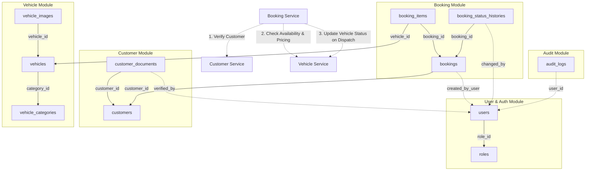

# ARBITRANS — System Architecture

This document defines the architectural blueprint of the **ARBITRANS** vehicle rental backend system, explaining component responsibilities, layer interactions, data flow, inter-module dependencies, and architectural constraints.

---

## 1. Project Overview

### 1.1 Purpose
**ARBITRANS** is a backend system designed for managing commercial vehicle rental operations. It coordinates vehicle fleet availability, customer identity verification, reservation scheduling, pricing calculations, status lifecycles, and security auditing.

### 1.2 Verified Technology Stack
The technology stack is verified against the repository's source code and configuration files:

- **Language:** Go `1.25.0` (`windows/amd64`)
- **HTTP Engine:** Gin (`github.com/gin-gonic/gin v1.12.0`)
- **Primary Database:** PostgreSQL 16
- **Database Driver & Connection Pool:** `pgxpool` (`github.com/jackc/pgx/v5 v5.9.2`)
- **Type-Safe SQL Generation:** sqlc (`v1.31.1`)
- **Database Schema Migrations:** golang-migrate (`v4`)
- **Authentication:** Custom stateless JWT (`crypto/hmac`, `crypto/sha256`, HS256)
- **Password Security:** `golang.org/x/crypto/bcrypt` (standard cost 10)
- **Cache & Key-Value Store:** Redis 7 (`github.com/redis/go-redis/v9 v9.7.0`)
- **Object Storage:** MinIO S3-compatible storage (`github.com/minio/minio-go/v7 v7.1.0`)
- **Structured Logging:** Go standard library `log/slog`
- **Request Validation:** `github.com/go-playground/validator/v10`
- **API Documentation:** OpenAPI 2.0 / Swagger UI (`github.com/swaggo/swag v1.16.4`)
- **Development Live Reload:** Air (`v1.65.1`)
- **Local Infrastructure:** Docker Compose (`docker-compose.yml`)

### 1.3 High-Level System Architecture
```
                         ┌─────────────────────────────┐
                         │   Client (Web / Mobile)     │
                         └──────────────┬──────────────┘
                                        │ HTTP / JSON
                                        ▼
┌─────────────────────────────────────────────────────────────────────────┐
│                        ARBITRANS Backend Binary                         │
│                                                                         │
│  ┌─────────────────── cmd/api/main.go (Entrypoint) ──────────────────┐  │
│  │                                                                   │  │
│  │  Middlewares: CORS ──► Logger ──► Recovery ──► BodySizeLimit     │  │
│  │                                                                   │  │
│  │  Routes:                                                          │  │
│  │   ├── /health            (Liveness & Component Dependency Probe)  │  │
│  │   ├── /swagger/*any      (Interactive OpenAPI Documentation)      │  │
│  │   └── /api/v1/ping       (Base API Route Group)                   │  │
│  │                                                                   │  │
│  └─────────────────────────────────┬─────────────────────────────────┘  │
│                                    │                                    │
│  ┌──────────────────────── internal/modules/ ────────────────────────┐  │
│  │  (Domain Business Modules: auth, user, customer, vehicle, booking)│  │
│  │                                                                   │  │
│  │   HTTP Handler ──► Domain Service ──► Repository (sqlc.Queries)   │  │
│  └───────────────────┬───────────────────────────────┬───────────────┘  │
│                      │                               │                  │
│  ┌───────────────────▼──────┐                 ┌──────▼───────────────┐  │
│  │     internal/shared/     │                 │   database/sqlc/     │  │
│  │  (Pool, JWT, Slog, etc.) │                 │ (Generated Queries)  │  │
│  └───────────┬──────────────┘                 └──────┬───────────────┘  │
└──────────────┼───────────────────────────────────────┼──────────────────┘
               │                                       │
               ▼                                       ▼
     ┌──────────────────┐                     ┌──────────────────┐
     │  Redis / MinIO   │                     │  PostgreSQL 16   │
     └──────────────────┘                     └──────────────────┘
```

### 1.4 Implementation Status vs. Planned Architecture
To avoid false assumptions during development, implementation status is explicitly separated:

- **Implemented & Verified**:
  - Shared infrastructure ([internal/shared/](file:///d:/PROJECT/Backend%20Project/backend-rental-vehicle/internal/shared)): pgxpool connection pool, Redis client with ping & fallback, MinIO client with `EnsureBucket` & sanitized uploads, JWT manager with algorithm verification, structured logging (`slog`), standard response envelope, validator error formatter, and Gin middlewares (CORS, RequestLogger, Recovery, BodySizeLimit).
  - Database schema & migrations ([database/migrations/](file:///d:/PROJECT/Backend%20Project/backend-rental-vehicle/database/migrations)): `000001_enable_extensions`, `000002_init_schema` (with enum drop rollback fix), `000003_booking_source_online`.
  - Type-safe queries ([database/sqlc/](file:///d:/PROJECT/Backend%20Project/backend-rental-vehicle/database/sqlc)): SQL queries in `database/queries/*.sql` compiled and verified via `sqlc compile` and `sqlc diff`.
  - HTTP server startup & graceful shutdown ([cmd/api/main.go](file:///d:/PROJECT/Backend%20Project/backend-rental-vehicle/cmd/api/main.go)).
- **Planned (Not Yet Implemented)**:
  - Business domain modules ([internal/modules/](file:///d:/PROJECT/Backend%20Project/backend-rental-vehicle/internal/modules)): Directory is currently unpopulated. No domain HTTP handlers, no business services, and no route registrations exist for `auth`, `user`, `customer`, `vehicle`, `booking`, or `audit`.

---

## 2. Application Structure

```text
/
├── cmd/
│   └── api/
│       └── main.go                  # Application entry point, dependency wiring, and shutdown
├── configs/                         # Centralized typed configuration and validation
│   ├── app.go                       # Server timeouts and runtime environment struct
│   ├── config.go                    # LoadConfig() and Config.Validate()
│   ├── config_test.go               # Configuration and validation unit tests
│   ├── cors.go                      # CORS configuration struct
│   ├── database.go                  # DatabaseConfig and GetDSN() using net/url
│   ├── env.go                       # getEnv helpers with type conversion
│   ├── jwt.go                       # JWTConfig struct
│   ├── minio.go                     # MinIOConfig struct
│   └── redis.go                     # RedisConfig struct
├── database/                        # Database schema, queries, and generated code
│   ├── migrations/                  # golang-migrate SQL DDL files (up/down)
│   ├── queries/                     # sqlc SQL query definitions (CRUD & aggregations)
│   └── sqlc/                        # Auto-generated type-safe Go code from sqlc
├── docs/                            # Canonical project documentation
│   ├── ARCHITECTURE.md              # System design and architecture (this file)
│   ├── PRD.md                       # Product requirements and business rules
│   └── RULES.md                     # Engineering and AI coding guidelines
├── internal/                        # Private application code
│   ├── app/                         # Application composition and module registry
│   ├── modules/                     # Business domain modules (PLANNED: auth, user, vehicle, etc.)
│   └── shared/                      # Domain-agnostic infrastructure components (IMPLEMENTED)
│       ├── audit/                   # Audit log helper
│       ├── constants/               # System enums (roles, vehicle/booking statuses)
│       ├── database/                # pgxpool factory and WithTransaction helper
│       ├── jwt/                     # HMAC-SHA256 token manager and unit tests
│       ├── logger/                  # Structured slog logger factory
│       ├── middleware/              # Gin middlewares (Auth, CORS, Logger, Recovery, BodyLimit)
│       ├── minio/                   # MinIO S3 client, EnsureBucket, file upload, presigned URLs
│       ├── redis/                   # Redis client factory with connection pooling
│       ├── response/                # Standardized JSON response envelope helpers
│       ├── utils/                   # Password bcrypt hashing and pgtype converters
│       └── validator/               # go-playground validation error formatter
├── AGENTS.md                        # AI developer entry point and instruction routing
├── docker-compose.yml               # Local infrastructure (PostgreSQL, Redis, MinIO, CloudBeaver)
├── sqlc.yaml                        # sqlc code generation configuration
├── .air.toml                        # Air live-reload configuration
├── .env.example                     # Environment variable template
└── go.mod / go.sum                  # Go module definition and dependencies
```

---

## 3. Modular Monolith Architecture

### 3.1 Principles
ARBITRANS is designed as a **Modular Monolith**:
1. **Single Deployable Unit**: Compiles into one executable Go binary, avoiding distributed systems overhead while enforcing logical separation.
2. **Domain-Driven Organization**: Features live in domain packages (`internal/modules/<domain>/`), not technical folders.
3. **Encapsulated Module Internals**: Each module encapsulates its internal domain rules and data access. Other modules communicate through public exported contracts (exported Service structs and DTOs).

### 3.2 Table Ownership Map & Inter-Module Dependencies



### Table Ownership Breakdown

| Module | Owned Database Tables | Cross-Module Foreign Keys | Dependencies on Other Modules |
| :--- | :--- | :--- | :--- |
| **`auth` / `user`** | `roles`, `users` | None | Foundational identity provider for staff and operators. |
| **`customer`** | `customers`, `customer_documents` | `verified_by` $\rightarrow$ `users(id)` | Depends on `user` for identifying verifying staff. |
| **`vehicle`** | `vehicle_categories`, `vehicles`, `vehicle_images` | None | Self-contained fleet inventory. Uploads media to MinIO. |
| **`booking`** | `bookings`, `booking_items`, `booking_status_histories` | `customer_id` $\rightarrow$ `customers(id)`<br>`vehicle_id` $\rightarrow$ `vehicles(id)`<br>`created_by_user` $\rightarrow$ `users(id)` | **Depends on `customer`** (KYC verification) and **`vehicle`** (availability, rates, status). |
| **`audit`** | `audit_logs` | `user_id` $\rightarrow$ `users(id)` | Observes mutations from all domain modules. |

---

## 4. How Booking Accesses Vehicles and Customers

The `booking` module coordinates the core business workflow and depends on `customer` and `vehicle`. To maintain modular boundaries without coupling database tables or making direct SQL updates across modules, interactions must follow explicit contracts:

### 4.1 Booking $\rightarrow$ Customer Interaction
When a reservation is initiated in `booking.Service.CreateBooking(ctx, req)`:
1. **Contract**: The `customer` module exports its concrete service:
   ```go
   // In internal/modules/customer/service.go
   func (s *Service) GetCustomerForBooking(ctx context.Context, customerID string) (*CustomerBookingDTO, error)
   ```
2. **Execution**:
   - `booking.Service` calls `customerService.GetCustomerForBooking(ctx, req.CustomerID)`.
   - `customer.Service` verifies that the customer exists, is not soft-deleted, and inspects `verification_status`.
   - If `verification_status != 'verified'`, the booking service rejects confirmation with `ErrCustomerNotVerified` (or marks the reservation `pending` document review based on PRD business rules).
3. **Data Boundary**: The `booking` module receives a read-only `CustomerBookingDTO` containing only the fields it needs (`ID`, `FullName`, `Phone`, `VerificationStatus`). It never writes to the `customers` table.

### 4.2 Booking $\rightarrow$ Vehicle Interaction
When checking vehicle availability and locking reservations:
1. **Contract**: The `vehicle` module exports:
   ```go
   // In internal/modules/vehicle/service.go
   func (s *Service) GetVehiclePricing(ctx context.Context, vehicleID string) (decimal.Decimal, error)
   func (s *Service) UpdateStatus(ctx context.Context, vehicleID string, status string) error
   ```
2. **Availability Check & Pricing**:
   - `booking.Service` verifies vehicle existence and retrieves active daily rate (`daily_price`) via `vehicleService.GetVehiclePricing`.
   - `booking.Service` checks for overlapping active reservations in `bookings` and `booking_items`.
3. **Double-Booking Concurrency Safeguard**:
   - To prevent two concurrent users from reserving the same vehicle on overlapping dates:
     ```go
     err := sharedDatabase.WithTransaction(ctx, pool, func(tx pgx.Tx) error {
         // Step 1: Acquire row-level lock on the vehicle
         var lockedID pgtype.UUID
         err := tx.QueryRow(ctx, "SELECT id FROM vehicles WHERE id = $1 FOR UPDATE", vehicleUUID).Scan(&lockedID)
         if err != nil {
             return fmt.Errorf("failed to lock vehicle: %w", err)
         }

         // Step 2: Check for overlapping bookings using sqlc transactional query
         qtx := queries.WithTx(tx)
         count, err := qtx.CountUnavailableVehicleBookings(ctx, countParams)
         if err != nil {
             return err
         }
         if count > 0 {
             return ErrVehicleUnavailable
         }

         // Step 3: Insert booking and booking items
         booking, err := qtx.CreateBooking(ctx, bookingParams)
         // ... insert booking items ...
         return nil
     })
     ```
4. **Dispatch Status Transition**:
   - When a booking transitions to `ongoing` (vehicle dispatched), `booking.Service` calls `vehicleService.UpdateStatus(ctx, vehicleID, "booked")`.
   - When returned (`completed`), it calls `vehicleService.UpdateStatus(ctx, vehicleID, "available")`.
   - **Boundary Rule**: `booking` **never** executes direct SQL `UPDATE vehicles` queries.

---

## 5. Request and Data Flow

All business operations follow a unidirectional request flow:

$$\text{Route} \longrightarrow \text{Handler} \longrightarrow \text{Service} \longrightarrow \text{Repository} \longrightarrow \text{Database}$$

```
[HTTP Request]
       │
       ▼
[Gin Route] ────────► Validates HTTP method and path
       │
       ▼
[Middleware] ───────► CORS ──► Logger ──► Recovery ──► BodyLimit ──► Auth/Roles
       │
       ▼
[Handler] ──────────► Binds JSON/Query, runs DTO validation, calls Service
       │
       ▼
[Service] ──────────► Executes business logic, enforces rules, coordinates Transactions
       │
       ▼
[Repository] ───────► Executes sqlc.Queries against pgxpool.Pool or pgx.Tx
       │
       ▼
[PostgreSQL] ───────► Executes SQL query, enforces DB constraints (FK, CHECK, UNIQUE)
```

### Layer Responsibilities
1. **HTTP Handler (`handler.go`)**:
   - Parses HTTP path parameters, query strings, and JSON request bodies into DTOs.
   - Validates DTOs using `internal/shared/validator`.
   - Injects user claims from `c.Get(middleware.UserClaimsKey)` into context.
   - Calls the corresponding Service method.
   - Writes standard responses using `internal/shared/response`.
2. **Service (`service.go`)**:
   - Implements business logic and domain validation (e.g., date interval checks, pricing calculations).
   - Coordinates transactions using `sharedDatabase.WithTransaction`.
   - Interacts with MinIO or Redis when required by the business use case.
   - Remains completely independent of Gin (`*gin.Context`).
3. **Repository (`repository.go`)**:
   - Wraps `*sqlc.Queries` generated code.
   - Translates database-specific errors into domain errors (e.g., `pgx.ErrNoRows` to `ErrNotFound`).
   - Supports transactional queries via `queries.WithTx(tx)`.

---

## 6. Startup and Infrastructure Flow

Application startup in [cmd/api/main.go](file:///d:/PROJECT/Backend%20Project/backend-rental-vehicle/cmd/api/main.go) executes in an explicit, deterministic order:

```mermaid
sequenceDiagram
    autonumber
    participant Main as main.go
    participant Cfg as configs.LoadConfig()
    participant Log as sharedLogger
    participant JWT as sharedJWT
    participant DB as sharedDatabase (pgxpool)
    participant Redis as sharedRedis
    participant MinIO as sharedMinIO
    participant Gin as gin.Engine
    participant HTTP as http.Server

    Main->>Cfg: LoadConfig() [.env + env vars]
    Note over Cfg: Validates env, ports, JWT length, CORS
    Main->>Log: NewLogger(cfg.App.Env)
    Main->>JWT: Init(cfg.JWT)
    Main->>DB: NewPostgresPool(ctx, cfg.DB) [MANDATORY]
    Note over DB: Performs immediate Ping; fails fast if offline
    Main->>Redis: NewClient(ctx, cfg.Redis) [OPTIONAL]
    Note over Redis: If offline, logs warning and continues
    Main->>MinIO: NewClient(cfg.MinIO) [OPTIONAL]
    Note over MinIO: Calls EnsureBucket(); logs warning if offline
    Main->>Gin: Initialize Engine & Middlewares
    Main->>HTTP: Start srv.ListenAndServe() in goroutine
    Main->>Main: Wait for OS SIGINT / SIGTERM
    Main->>HTTP: srv.Shutdown(shutdownCtx) [Graceful timeout]
    Main->>DB: pool.Close() [Deferred]
    Main->>Redis: redisClient.Close() [Deferred]
```

### Dependency Classification
- **Mandatory Core Dependency**:
  - **PostgreSQL**: Required for application operation. If connection or ping fails, startup terminates immediately with `os.Exit(1)`.
- **Optional Infrastructure Dependencies**:
  - **Redis**: Caching layer. If Redis is disabled (`REDIS_ENABLED=false`) or unreachable, the application logs a warning and operates without cache.
  - **MinIO**: Object storage. If MinIO is unreachable during startup, the application logs a warning and proceeds. Bucket availability is verified without blocking server boot.

---

## 7. Database and External Services

### 7.1 Database Schema Authority
- **Authoritative Source**: The SQL files in `database/migrations/` are the **single source of truth** for database schema.
- **golang-migrate**: Manages versioning in PostgreSQL's `schema_migrations` table.
- **sqlc**: Reads the migration files (`database/migrations/`) and query files (`database/queries/`) to generate compile-time verified Go code in `database/sqlc/`.

### 7.2 External Services Role Matrix

| Service | Technology | Role in ARBITRANS | Fallback Behavior |
| :--- | :--- | :--- | :--- |
| **Database** | PostgreSQL 16 | Relational data, foreign keys, transaction ACID integrity, constraints. | Mandatory. Application terminates if unreachable. |
| **Cache** | Redis 7 | Transient query caching, rate limiting, session storage. | Optional. System falls back to direct database reads if offline. |
| **Storage** | MinIO (S3) | Binary storage for customer KYC documents and vehicle images. | On-Demand. Operations not requiring uploads remain functional. |
| **Web DB UI**| CloudBeaver | Development inspection of schemas, tables, and records. | Development tool only. Not used by backend binary. |

---

## 8. Architectural Constraints

1. **Transaction Integrity**: Multi-table mutations must use `sharedDatabase.WithTransaction`.
2. **Double-Booking Prevention**: When creating bookings, concurrent requests must be synchronized using row-level locking (`SELECT ... FOR UPDATE`) or serializable isolation to prevent overlapping reservations for the same vehicle.
3. **Stateless Authentication**: User sessions are stateless, verified via JWT Bearer tokens. Revocation, if required in the future, will use Redis token blacklisting.
4. **Compile-Time SQL Safety**: Direct SQL strings in Go code are prohibited. All database queries must be authored in `database/queries/*.sql` and compiled via `sqlc`.
5. **Separation of Infrastructure and Business Logic**: Packages in `internal/shared/` must never import packages from `internal/modules/`.
